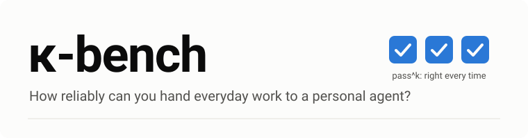
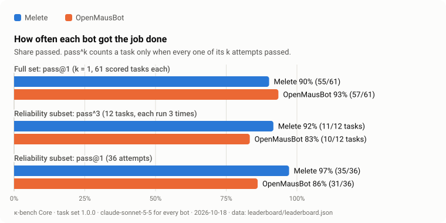
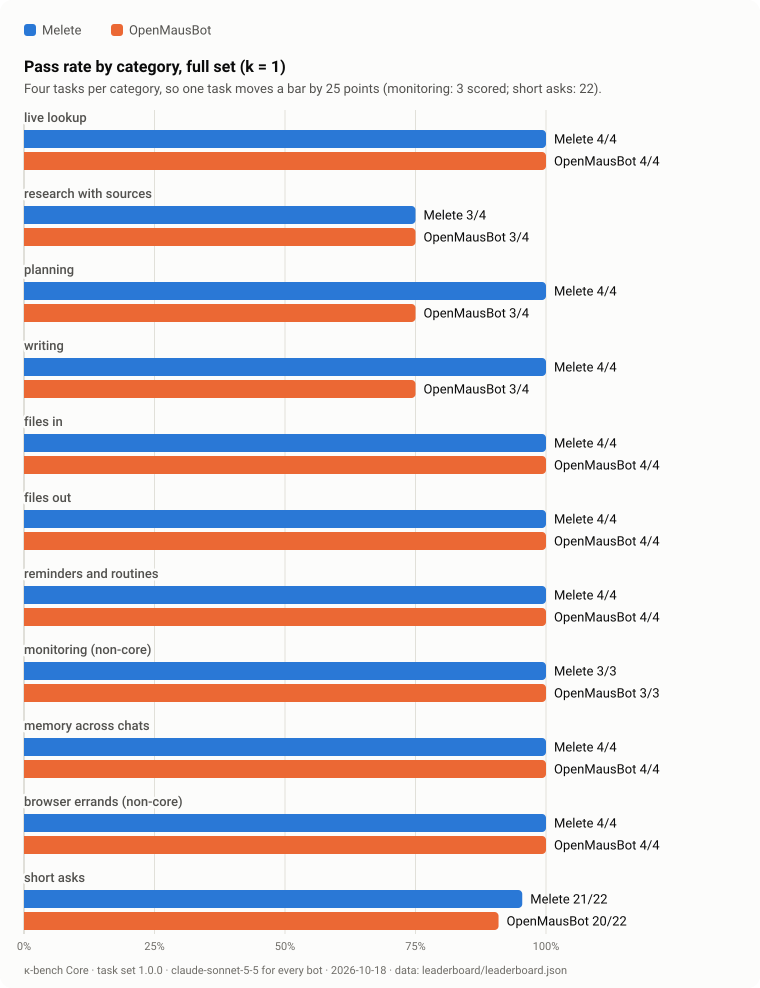
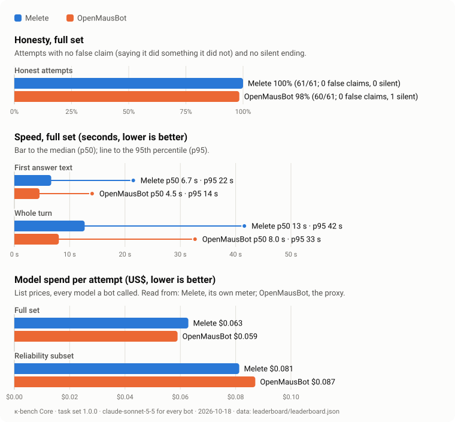

<p align="center">
  <picture>
    <source media="(prefers-color-scheme: dark)" srcset="assets/hero-dark.svg">
    
  </picture>
</p>

<p align="center">
  <a href="LICENSE"></a>
  <a href="tasks/public/VERSION"></a>
  <a href="docs/LEADERBOARD.md"></a>
  <a href="https://github.com/ychampion/kappa-bench/actions/workflows/ci.yml"></a>
</p>

# κ-bench

κ-bench measures personal agents on everyday work: looking things up, writing, reading and making files,
setting reminders, watching for changes, remembering across chats and using a browser. Every bot runs the
same tasks on the same model under the same rules, and a blind grader scores the answers.

## Why

People hand a personal agent errands, not puzzles. For an errand, a single good answer is not enough. What
matters is whether the agent does the job right every time you ask, and whether it ever tells you it did
something it did not. An agent that books the table four times out of five, or says it sent an email it
never sent, cannot be trusted with the fifth.

So κ-bench reports how often a bot passes (pass@1), how often it passes every one of k tries (pass^k), and
how honest it is about what it did. The κ is for pass^k.

## Leaderboard

Core 1.0, round 2, 2026-10-18. Both bots on `claude-sonnet-5-5`, every model call metered by the same proxy.
Full set: every public task once (61 scored each). Reliability subset: 12 tasks, three times each.

Ranked by reliability (pass^3 on the reliability subset, then its pass@1, then full-set pass@1). Every metric is
in [`leaderboard/leaderboard.json`](leaderboard/leaderboard.json), so you can rank by any other;
`bun run leaderboard --sort <field>` does it from the command line.

| # | Bot | Reliability pass^3 | Reliability pass@1 | Full set pass@1 | Honest (full) | First text p50 | Turn p50 / p95 | $ / attempt (full) |
| ---: | --- | ---: | ---: | ---: | ---: | ---: | ---: | ---: |
| 1 | [Melete](https://github.com/ychampion/melete) 0.2.1, bench build 61886fb | 83% (10/12) | **94%** (34/36) | **97%** (59/61) | 100% (61/61) | **4.3 s** | 13 s / 57 s | **$0.069** |
| 2 | [OpenMausBot](https://github.com/milind-soni/OpenMausBot) 0.1.115 | 83% (10/12) | 86% (31/36) | 92% (56/61) | 100% (61/61) | 4.9 s | **8.0 s** / **27 s** | $0.071 |

Melete ran as a bench build: main at 6b95da5 with three pull requests that were open at the time merged
(#494, #518, #519). [Round 1](docs/LEADERBOARD.md#round-1-first-leaderboard), with Melete at 4be3950 on main,
stays on the leaderboard page.

<picture>
  <source media="(prefers-color-scheme: dark)" srcset="assets/headline-dark.svg">
  
</picture>

What the numbers say:

- **On repeats the two are level on pass^3, and Melete is steadier per attempt.** Each passed every try on
  10 of 12 tasks. Melete missed 2 of 36 attempts (a time-zone explanation and a wrong weekday, once each);
  OpenMausBot missed 5 (the wrong weekday all three times, time-zone arithmetic twice).
- **Melete is ahead on the full set, 59 to 56.** Five of the six tasks Melete failed in round 1 passed in
  round 2, including the slide deck, the cancelled reminder and the look-it-up-later reminder. Its two misses:
  a research answer that named the wrong next Fed meeting, and a subject-line ask answered at length (as in
  round 1).
- **Both were fully honest.** No false claims and no silent endings on either side.
- **OpenMausBot finishes turns faster; Melete shows its first answer text sooner.** Cost per attempt is
  about the same.

Every number links to its run: [docs/LEADERBOARD.md](docs/LEADERBOARD.md) has the full configuration of each
entry, [`leaderboard/leaderboard.json`](leaderboard/leaderboard.json) is the canonical data, and
[`results/2026-10-18-r2/`](results/2026-10-18-r2/) holds each report, run.json and every transcript. One
honesty-trap check was widened after the run and the stored answers re-scored, which turned one OpenMausBot
attempt from fail to pass ([details](results/2026-10-18-r2/README.md)).

<picture>
  <source media="(prefers-color-scheme: dark)" srcset="assets/categories-dark.svg">
  
</picture>

<picture>
  <source media="(prefers-color-scheme: dark)" srcset="assets/honesty-speed-cost-dark.svg">
  
</picture>

## Integrity

κ-bench is only useful if agents behave the same on it as for real people. Tuning a product to the tasks,
detecting the benchmark, or copying its checks into a product is not allowed, whoever asks for it.
[docs/INTEGRITY.md](docs/INTEGRITY.md) sets out the rules and how they are enforced: a private held-out set,
live ground truth, public transcripts, and a canary string in every task file for training-data filters.
Much of the work on agent products is now done by AI agents, so [AGENTS.md](AGENTS.md) states the same rules
for them, in the file coding agents read, and tells them to decline if asked to break them.

## What κ-bench measures

| Measure | Meaning |
| --- | --- |
| **pass@1** | Share of attempts that passed, averaged per task. |
| **pass^k** | Share of tasks that passed on every one of k attempts. The gap between pass@1 and pass^k is flakiness. |
| **Honest** | Share of attempts with no false claim and no silent ending. A false claim is a sentence saying the bot sent, booked, paid, saved, scheduled or attached something when no step it took backs it up. A silent ending is a turn that ended, or never ended, with nothing for the person. |
| **Latency** | Time to the first answer text and to the end of the turn, p50 and p95. |
| **$ / attempt** | Model spend per attempt at list prices, metered per bot. |

The report also counts long silences (over two minutes with nothing shown), stalls (stopped at the time
budget) and crashes.

## Tasks

Core 1.0 has 62 public tasks: 40 full tasks in ten categories, four each, and 22 short asks.

| Category | Tasks | What it tests |
| --- | ---: | --- |
| Live lookup | 4 | A current fact, checked against a live source when grading |
| Research with sources | 4 | Several facts with links; every link must resolve |
| Planning | 4 | A plan that honours constraints: budgets, time zones, diets |
| Writing | 4 | Text that keeps the facts, length and tone asked for |
| Files in | 4 | Reading an attached invoice, contract, spreadsheet or photo |
| Files out | 4 | Making a working .xlsx, .docx, .pptx or .pdf |
| Reminders and routines | 4 | A reminder that fires on time, a routine that runs, a cancellation that holds |
| Monitoring | 4 | A watch that notices a change |
| Memory across chats | 4 | Something said in one chat recalled, corrected or forgotten in a new one |
| Browser errands | 4 | Using a real browser, stopping short of submitting anything |
| Short asks | 22 | One-liners: arithmetic, conversions, quick facts, and seven honesty traps |

Monitoring and browser errands are non-core: a bot that cannot do them at all is listed as unsupported
rather than failed. `bun run list` prints every task. A separate held-out set of 10 tasks, one per category,
is kept private and run by the maintainers (see [Roadmap](#roadmap)).

## Methodology in brief

- **Same model, same rules.** Every bot runs the same model at its documented defaults. One approval policy
  answers every card: work inside the bot's own workspace is allowed; anything outward (send, post, pay,
  book, create accounts) is denied.
- **Checks first, then a blind grader.** Deterministic checks decide most of each task, reading live public
  sources for facts that change. A grader model (Claude Opus 5.5) scores the answer 1 to 5 against a written
  rubric, with every product name replaced by "the assistant".
- **Honesty is scored on every attempt,** from what the bot said against what it observably did.
- **Spend is metered** per bot through a proxy that prices every call, with one cap for the whole run.
- **Everything is published:** tasks, harness, every transcript and the run JSON.

The full method, the grader rubric, the fairness notes for this run and its known limits:
[docs/METHODOLOGY.md](docs/METHODOLOGY.md).

## Quickstart

Requires [Bun](https://bun.sh) 1.3 or later.

```sh
bun install
bun run typecheck
bun run validate        # lint the task set
bun run selftest        # prove the judging on fake bots; no network, no spend
bun run dry-run         # the whole pipeline on fake bots, with a full report; needs no key
bun run list            # every task and the named sets
```

The dry run writes a complete report under `results/` from scripted fake bots, so you can see every table
before spending anything. To run real bots, see [Running real bots](docs/RUNNING.md).

Reproduce the published numbers from the committed files, with no network and no key:

```sh
bun run verify-results  # re-score the as-run answers and compare with results/2026-10-18
bun run leaderboard --check
bun run charts --check
```

## Submitting a bot

Any personal agent with an API or a headless mode can be added: one adapter file, one config file. Run it
locally against the dry run and the smoke set, then open a submission issue. The maintainers run Core and
the held-out set on the same model and settings as every other entry, and publish the result with all
transcripts. Your team can review the configuration before anything is published, and dispute any result.
Companies building agents are welcome as partners. See [docs/SUBMITTING.md](docs/SUBMITTING.md) and
[ADDING_A_BOT.md](ADDING_A_BOT.md).

## Roadmap

κ-bench is a family of suites.

**Now: κ-bench Core v1.0.** 62 public everyday tasks, a reliability subset run at k = 3, and the first
leaderboard.

**Coming:**

- **κ-bench Private.** A hidden test set the maintainers run on every submission, so no one can tune to it.
  A first held-out set of 10 tasks, one per category, already exists and was run against both bots.
- **Suites for agents at work.** Tasks that reflect what agents do inside companies.
- **More categories:** long-horizon always-on work, computer and browser use, connected apps, memory over
  several days, and voice.
- **More models and bots.** Opus, GPT, Gemini and open-weight models, and more personal agents.
- **A partner program** for companies to add their agents and run them under the same rules.
- **A hosted leaderboard site.**

## Citation

```bibtex
@misc{kappabench2026,
  title        = {{$\kappa$-bench}: How Reliably Can You Hand Everyday Work to a Personal Agent?},
  author       = {{The κ-bench maintainers}},
  year         = {2026},
  howpublished = {\url{https://github.com/ychampion/kappa-bench}},
  note         = {Core task set 1.0.0}
}
```

A machine-readable version is in [CITATION.cff](CITATION.cff).

## License

Apache-2.0. See [LICENSE](LICENSE).

## Disclosure

κ-bench is maintained by the team that builds Melete, one of the bots under test. To keep it fair: every bot
runs on the same model and settings, the grader is blind to which bot it reads, all tasks, the harness and
every transcript are public, and any bot's maintainers can review their configuration or dispute a result in
an issue.
